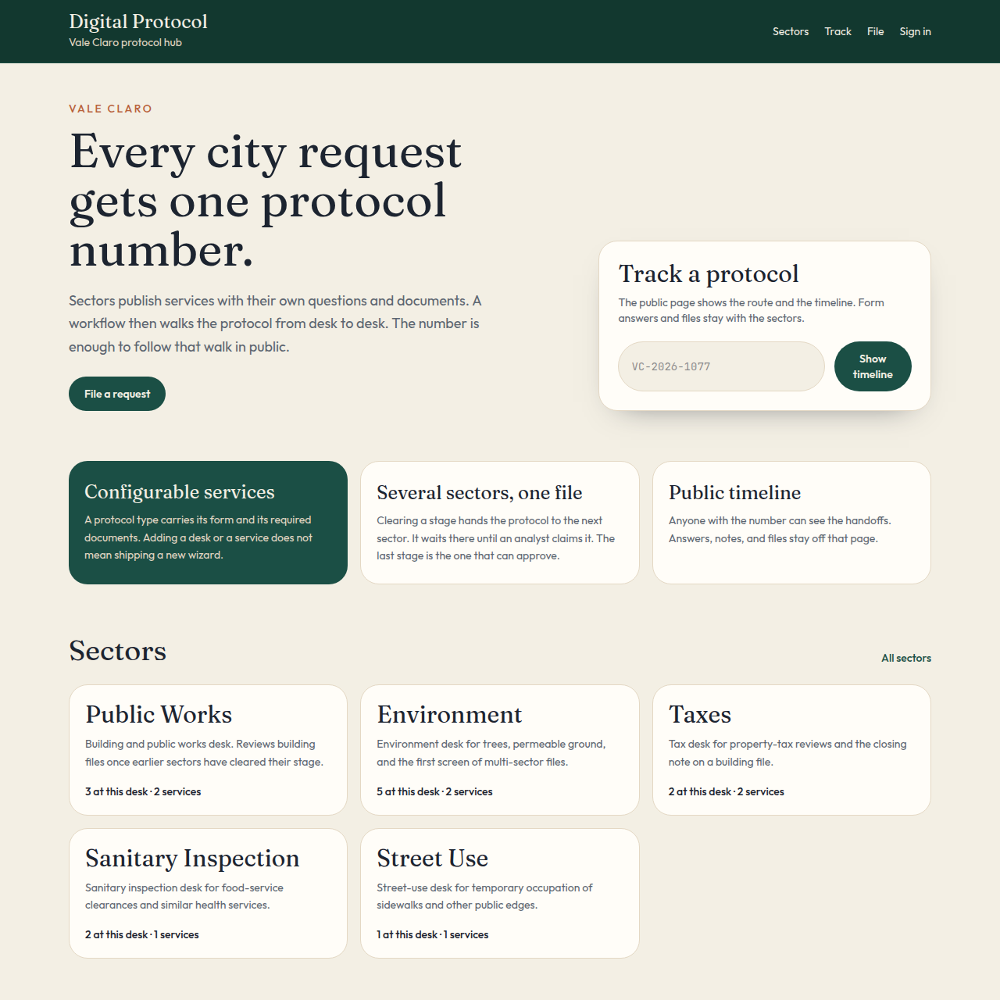
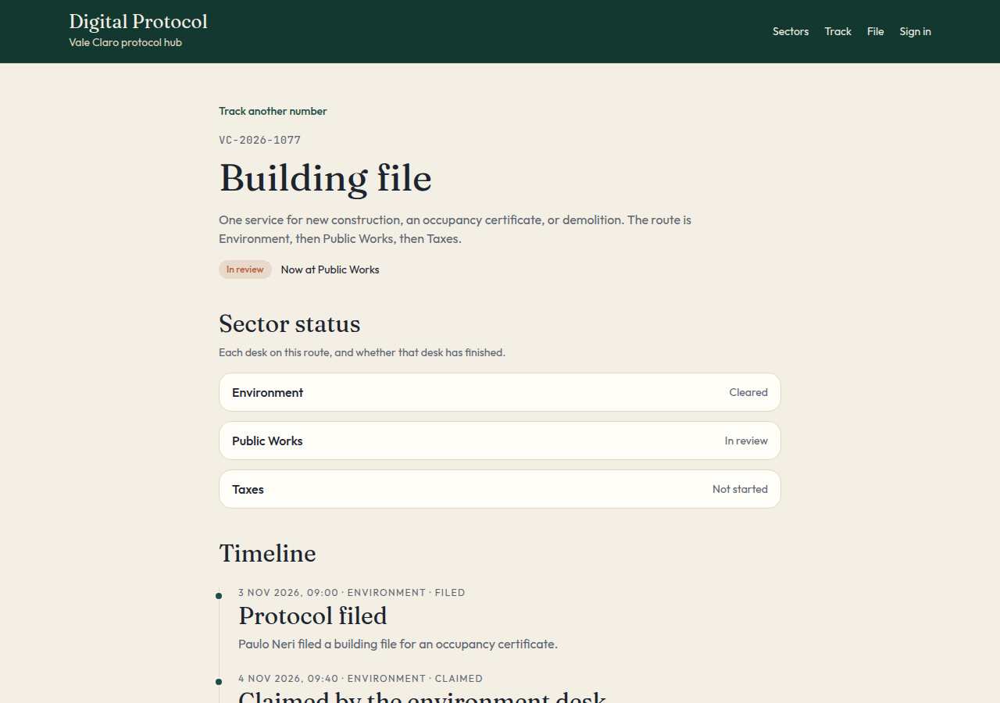
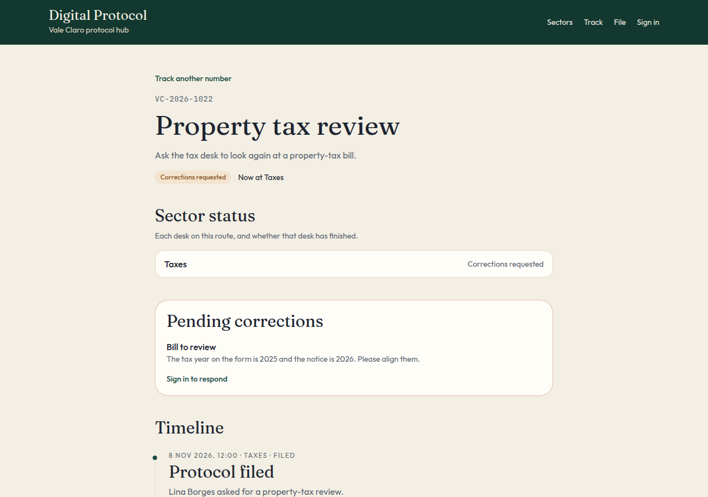
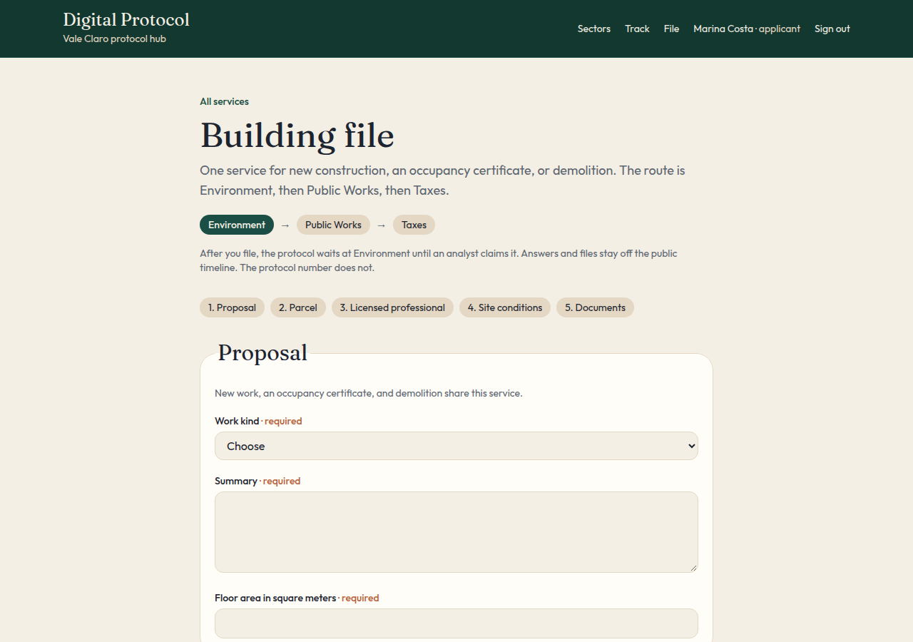
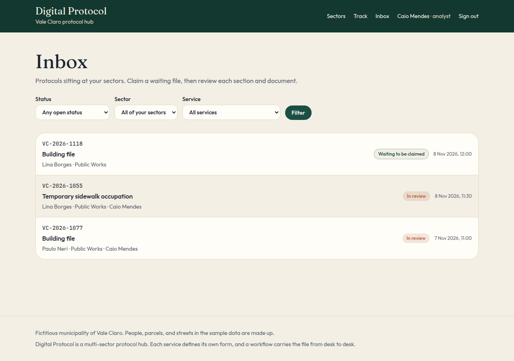
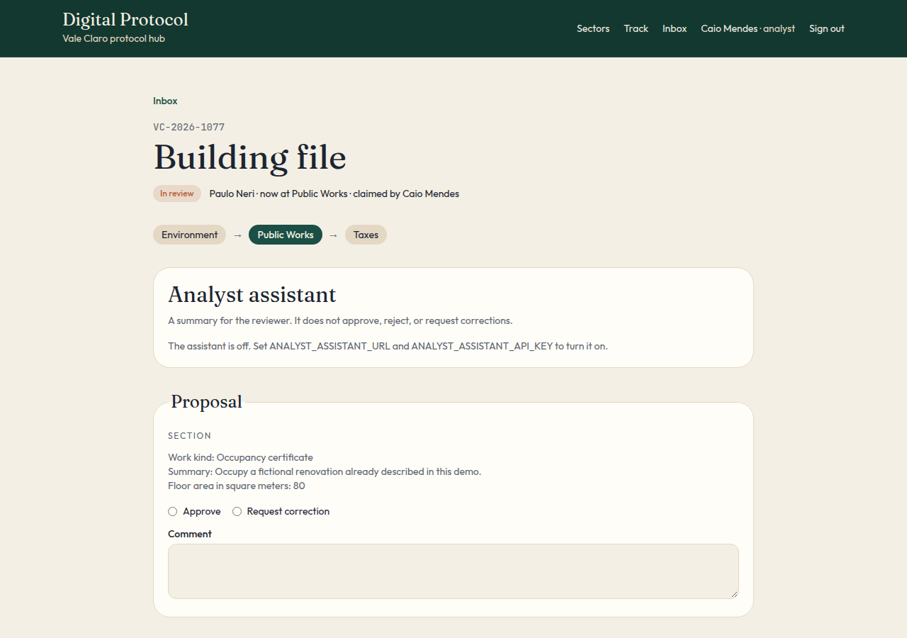
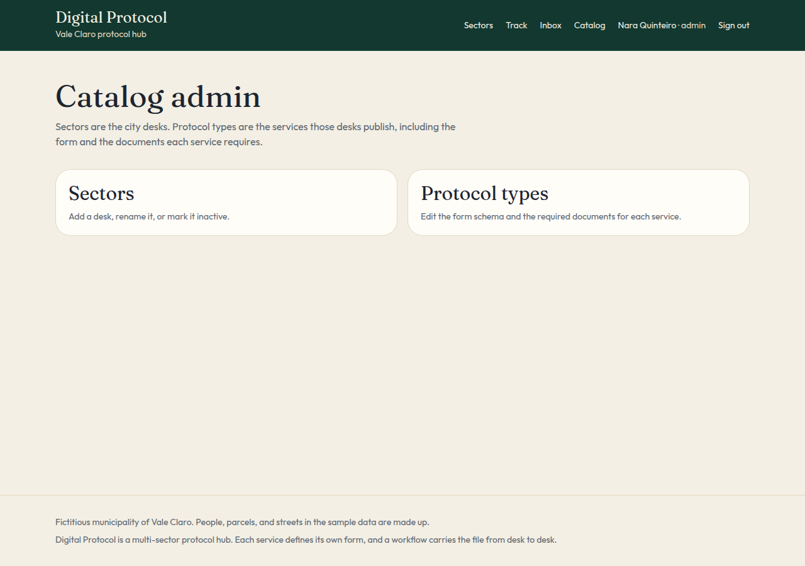

# Digital Protocol

Digital Protocol is an open-source hub for municipal requests. A person files one protocol, and the file moves between city sectors until the last desk on its route issues a decision or closes it. The sample city is **Vale Claro**. Every person, parcel, and street in the seed data is fictitious.

A building file is one service in that catalog, alongside street-tree care, property-tax review, food-service clearance, and temporary sidewalk occupation. New sectors and new forms are catalog data. They are not separate products and they do not need a new wizard.

## Features

- Sector, workflow, protocol type, protocol, review, timeline, and user models.
- Protocol types store a form schema (sections and fields) and the documents they require. Zod checks the catalog and the answers.
- A status machine for `draft`, `submitted`, `in_review`, `corrections_requested`, `approved`, and `rejected`, plus a handoff rule for multi-sector routes.
- Sign-in for applicants, analysts, and admins. An analyst sees only the sectors on their account.
- An applicant form rendered from the chosen protocol type, with required-document uploads stored through a local disk driver in development.
- An analyst inbox with claim, section and document review, handoff, issuance, and rejection.
- A corrections loop. The applicant sees the open requests, edits those parts, and resubmits. Earlier timeline events stay in place.
- A public tracking page. Anyone with the protocol number can see each sector's status and the public timeline. Answers, notes, and files stay off that page.
- Admin screens for sectors and protocol types.
- An optional analyst assistant. It stays off unless both `ANALYST_ASSISTANT_URL` and `ANALYST_ASSISTANT_API_KEY` are set, and it only writes a summary.

## Screenshots

These pages were captured from a local run seeded with the fictitious city of Vale Claro.















## Setup

Requires Node.js 22+ and MongoDB 6 or newer.

```bash
npm install
cp .env.example .env
```

Environment variables, from `.env.example`:

| Variable                    | Required | Purpose                                                                                               |
| --------------------------- | -------- | ----------------------------------------------------------------------------------------------------- |
| `MONGODB_URI`               | Yes      | Database URI. The example points at `mongodb://127.0.0.1:27017/digital_protocol`.                     |
| `SESSION_SECRET`            | Yes      | Signs the session cookie. The example is a placeholder. Replace it before any shared deployment.      |
| `UPLOAD_DIR`                | No       | Directory for uploaded documents. The default is `data/uploads`, which is not part of the repository. |
| `ANALYST_ASSISTANT_URL`     | No       | Optional summary endpoint. Leave unset to keep the assistant off.                                     |
| `ANALYST_ASSISTANT_API_KEY` | No       | Bearer token for that endpoint. Both this and the URL must be set, or the assistant stays off.        |

Do not put real credentials in `.env.example`.

Start MongoDB, load the sample city, and run the app:

```bash
# example if you use Docker
docker run --name digital-protocol-mongo -p 27017:27017 -d mongo:7

npm run seed
npm run dev
```

Open [http://localhost:3000](http://localhost:3000).

`npm run seed` deletes and rewrites the `digital_protocol` database. It refuses to load a catalog that breaks the status machine, the route, or a form schema. Every fictitious account uses the password `vale-claro-demo`.

| Role                   | Email                           |
| ---------------------- | ------------------------------- |
| Applicant              | `marina.costa@valeclaro.test`   |
| Analyst (Environment)  | `helena.duarte@valeclaro.test`  |
| Analyst (Public Works) | `caio.mendes@valeclaro.test`    |
| Admin                  | `nara.quinteiro@valeclaro.test` |

Sign in at `/sign-in`. Applicants open `/file`. Analysts open `/desk`. Admins open `/admin`. Track a number at `/track`.

Useful sample numbers:

| Number         | What it shows                                                                         |
| -------------- | ------------------------------------------------------------------------------------- |
| `VC-2026-1077` | Occupancy certificate, in review at Public Works after Environment cleared its stage. |
| `VC-2026-1118` | Building file waiting to be claimed at Public Works.                                  |
| `VC-2026-1022` | Property-tax review with a correction still open.                                     |
| `VC-2026-1014` | Street-tree file that went out for a correction and came back.                        |
| `VC-2026-1124` | Building file approved after all three sectors.                                       |
| `VC-2026-1088` | Draft. The public page says it is not filed yet and hides the answers.                |

```bash
npm run dev        # local app
npm run lint       # eslint
npm test           # status machine, filing, uploads, passwords, tracking, and the catalog
npm run typecheck  # tsc --noEmit
npm run build      # production build
npm run seed       # fictitious Vale Claro data
```

## Architecture

The app is a Next.js 16 App Router project in TypeScript. MongoDB is accessed through Mongoose. Tailwind styles the pages. Zod validates catalog edits, filing answers, review actions, and sector input. The domain rules live in `lib/` and are covered by Node's test runner, separate from the route handlers.

```
app/         routes: /, /sectors, /file, /desk, /track, /admin, and the JSON APIs
components/  header, forms, timeline, and the route strip
lib/         status machine, review rules, tracking, assistant, uploads, sessions
models/      Mongoose models
scripts/     Vale Claro catalog and the seed loader
```

### Sectors

A sector is a city desk: Public Works, Environment, Taxes, Sanitary Inspection, and Street Use in the sample. Each sector publishes services and owns the stages assigned to it. An analyst account lists the sector keys it may cover. Admins can create, rename, deactivate, and remove a sector unless a workflow, an analyst, or a protocol still uses it.

### Protocol types

A protocol type is one service. It names the sector that publishes it, the workflow that routes it, a form schema, and a list of documents. The form schema is sections and fields (`text`, `textarea`, `number`, `date`, `select`, `boolean`). The filing page reads that schema. It does not hard-code a wizard per service. The building file is the long example: work kind (new construction, occupancy certificate, or demolition), parcel, licensed professional, and site conditions, plus a survey sheet, a technical responsibility record, and a site note.

### Workflows

A workflow is an ordered list of stages. Each stage names the sector that owns it. The sample catalog has single-desk workflows (Environment, Taxes, Sanitary Inspection) and two longer ones. Temporary sidewalk occupation goes to Street Use, then Public Works. The building file goes to Environment, then Public Works, then Taxes. Adding a route means adding workflow data, not a new page.

### Routing

`lib/protocol-flow.ts` is the source of truth for status and handoff.

| From                    | To                      | When                                                                                                               |
| ----------------------- | ----------------------- | ------------------------------------------------------------------------------------------------------------------ |
| `draft`                 | `submitted`             | The applicant files the protocol.                                                                                  |
| `submitted`             | `in_review`             | An analyst at the current sector claims it.                                                                        |
| `in_review`             | `corrections_requested` | That sector sends the file back.                                                                                   |
| `corrections_requested` | `submitted`             | The applicant returns the correction.                                                                              |
| `in_review`             | `submitted`             | The sector clears its stage and a later sector is still on the route. The file waits, unclaimed, at the next desk. |
| `in_review`             | `approved`              | The sector clears its stage and it is the last one.                                                                |
| `in_review`             | `rejected`              | The sector closes the file.                                                                                        |
| `approved`, `rejected`  | —                       | Terminal.                                                                                                          |

`submitted` means "waiting to be claimed at the current sector". That is true just after filing, after a correction comes back, and after the previous sector hands the file on. Approving is refused while a later stage still exists. `handoffAfterClearance` encodes that choice. A section decision (`pending`, `cleared`, `changes_requested`) does not by itself change the protocol status.

### Public tracking

`/track/[code]` is public. `lib/tracking.ts` labels every sector on the route: cleared, in review, waiting to be claimed, corrections requested, not started, issued, or closed. The page also lists pending correction comments and the public timeline. Drafts say they are not filed yet and hide the answers. Internal events stay off the page. A read-only JSON view of the same public record is at `/api/protocols/[code]`.

### Analyst review

`/desk` lists protocols at the signed-in analyst's sectors, filtered by status, sector, and service. Claiming a `submitted` protocol moves it to `in_review`. The review screen shows the route, each form section, and each document. The analyst approves an item or requests a correction with a comment, then saves, sends the file back, hands it to the next sector, issues the approval, or rejects it. Issuing is only offered on the last stage, and only when every item is cleared.

### Corrections loop

When a sector requests corrections, the protocol becomes `corrections_requested` and the comments appear on the public timeline and in the applicant's account. The applicant edits the flagged parts at `/file/correct/[code]` and resubmits. The file returns to `submitted` at the same desk, with no assignee, and the earlier timeline events remain.

### Optional assistant

The review screen can ask an external endpoint for a short summary of the protocol. `lib/assistant.ts` sends a JSON brief (service, status, route, section text, document names, and open corrections) and expects `{ "summary": "..." }`. The button is hidden unless both `ANALYST_ASSISTANT_URL` and `ANALYST_ASSISTANT_API_KEY` are set. The assistant does not approve, reject, or request corrections. The instruction sent with the brief says the same thing.

## Future ideas

- Password reset, invitations, and self-service registration.
- Workflow editing in the admin UI, and an audit entry for each catalog change.
- Saving a draft and finishing it later.
- Document previews, and a storage driver other than local disk.
- A document checklist and suggested notes from the assistant, still without filing a decision.
- Optional fees, email notifications, stage deadlines, an internal audit log, and a signed final decision.
- Route-level tests, and CI that runs lint, typecheck, test, and build on each pull request.

## License

MIT. See [LICENSE](LICENSE).
